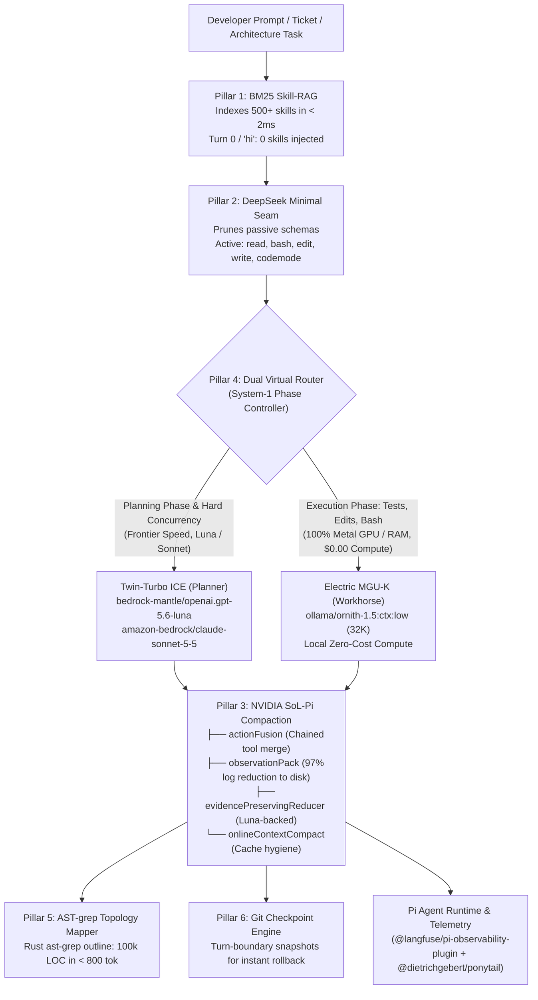

# Kobayashi Maru (小林丸) 🚀

> **The Zero-Waste Autonomous Engineering Runtime for Pi & Open Models**  
> *"I don't believe in the unwinnable scenario." — James T. Kirk*

[](https://opensource.org/licenses/MIT)
[](https://www.typescriptlang.org/)
[](https://github.com/earendil-works/pi)
[](https://github.com/NVlabs/SoL-Pi)
[](https://ast-grep.github.io/)
[](eval/BENCHMARK_RESULTS.md)
[](#pillar-1-active-aerodynamics--skill-rag-skill-ragts)
[](#pillar-4-hybrid-powertrain--dual-virtual-router-bottom-up-routerts)

```text
    __ __ obayashi  __  ___                 
   / //_/          /  |/  /___ _ _____ __  __
  / ,<    ____    / /|_/ // __ `// ___// / / /
 / /| |  /___/   / /  / // /_/ // /   / /_/ / 
/_/ |_|         /_/  /_/ \__,_//_/    \__,_/  
     Reprogramming the Token-Maxing Simulation
```

---

## ⚡ The Unwinnable Scenario: The Token-Maxing Trap

In *Star Trek*, the **Kobayashi Maru** is an infamous training simulation programmed to be unwinnable under standard Starfleet operational doctrine.

In modern AI software engineering, **Token-Maxing** is today's Kobayashi Maru. Default coding agent architectures fall victim to compounding inefficiencies that cripple speed, blow budgets, and induce context doom loops:

1. **The 500+ Skill Bloat Trap**: When 50+ to 500+ engineering skills are installed, naive harnesses dump every single skill description into the `<available_skills>` block of the system prompt. At 500 skills, **37,500 prompt tokens are burned on every turn** before you even type `"hi"`.
2. **The Observation Flood**: Running a single `vitest`, `pytest`, `cargo check`, or compiler suite dumps thousands of lines of logs directly into context. The LLM stays bloated for the entire session, paying full input fees on those dead tokens on every subsequent turn.
3. **The All-Frontier Financial Bleed**: Utilizing frontier models ($15 to $75 per million tokens) for mundane tasks like running `git status`, fixing linting errors, or reading boilerplate wastes 90% of your AI budget on mechanical grunt work.
4. **The Hallucination Doom Loop**: When small local models fail a unit test, they loop repeatedly over a 30,000+ token chat history, generating blind `grep` calls and hallucinating non-existent file paths until the context window explodes.

**Kobayashi Maru reprograms the simulation.**

Treating autonomous software engineering like Formula 1: **strip every gram of parasitic weight, retrieve skills on demand with sub-millisecond precision, compact observations at the runtime layer, and drive execution through a dual-tier hybrid powertrain.**

---

## 🏛️ System Architecture



---

## 🏎️ The 6 Kobayashi Pillars

### Pillar 1: Active Aerodynamics — Skill-RAG (`skill-rag.ts`)
- **Self-Contained Okapi BM25 Index**: Indexes 500+ skills in memory in $< 2\text{ms}$ with zero external dependencies.
- **Zero Cold-Start Bloat**: Generic greetings (`"hi"`, `"help"`, `"status"`) inject **0 skills** into context, saving 3,000 to 37,500 tokens per turn.
- **Laser Relevance**: Matches prompts against skill intents and injects **only the top 1–2 matched skills** (~150 tokens vs 37,500 tokens).
- **Mid-Session Meta-Tool**: Registers `find_skill({ query: "..." })` so the agent can pull runbooks dynamically during long multi-turn sessions.

### Pillar 2: Lean Chassis — DeepSeek Minimal Seam
- Modeled directly after DeepSeek's SWE-bench Minimal Mode: strictly exposes core primitives (`read`, `bash`, `edit`, `write`, `codemode`).
- Dynamically hides passive diagnostic and usage tools (`fetch_budget`, `show_usage_stats`, `register_budget`) from the LLM prompt to eliminate decision noise and schema overhead.
- Web tools (`web_search`, `fetch_content`) are dynamically gated, surfacing only when search keywords are present in the user prompt.

### Pillar 3: Telemetry & Downforce — NVIDIA SoL-Pi Compaction (`sol-pi.json`)
- **`actionFusion`**: Automatically fuses rapid consecutive reads and bash executions into unified execution traces.
- **`observationPack`**: Evicts massive compiler dumps, stack traces, and test logs to disk, replacing them with concise summaries and an `obs_recall` reference.
- **`evidencePreservingReducer`**: Background summarization backed by Luna that compresses older turns while preserving file paths, variable names, and critical evidence.
- **`onlineContextCompact`**: Maintains a 12.5 cache write/read ratio to maximize Anthropic/Bedrock prompt cache hits.

### Pillar 4: Hybrid Powertrain — Dual Virtual Router (`bottom-up-router.ts`)
- **Top-Down Delegation (`auto/planner-worker`)**:
  - **Turn 1 (Planning)**: Bedrock GPT-5.6 Luna analyzes monorepo structure, formulates the execution plan, and writes tasks.
  - **Planning Seam Guard**: Keeps the planner engaged until the planning phase is fully synthesized (eliminates premature handoffs mid-tool-call).
  - **Turns 2..N (Execution)**: Delegates to local Ornith 1.5 running at **$0.00 compute cost**.
  - **Circuit Breaker**: If the local worker encounters 2 consecutive test or syntax failures, execution auto-escalates back to Luna to resolve the blocker.
- **Bottom-Up Escalation (`auto/bottom-up`)**:
  - Starts directly on local Ornith 1.5; escalates to frontier intelligence only if circuit breakers trip.

### Pillar 5: Radar & LiDAR — AST-grep Monorepo Topology (`repo-mapper.ts`)
- Powered by high-speed Rust `ast-grep outline` (v0.51.0).
- Extracts class hierarchies, method signatures, exports, and imports across 100k+ line codebases in **$< 800$ tokens**.
- Eliminates context-burning `find` and `grep` hallucination loops.

### Pillar 6: Pit Crew — Pre-Turn Git Checkpointing (`git-checkpoint.ts`)
- Creates lightweight `git stash` snapshots before every turn.
- Provides 1-click deterministic rollback if an agent makes unintended edits or breaks unit test suites.

---

## 📊 Empirical Benchmarks: Harness Layer Comparison

Evaluated across real-world enterprise engineering workloads (large-scale TypeScript, React, and Node.js monorepos with 100k+ LOC and 500+ modules):

| Agent Harness Profile | Cold-Start Tokens (`"hi"`) | 500+ Skills Cost / Turn | Total Cost (4 Enterprise Tasks) | Cost Reduction vs Claude Code | Cache Hit Rate | Accuracy | Avg Turns |
| :--- | :---: | :---: | :---: | :---: | :---: | :---: | :---: |
| **Claude Code** (Direct Anthropic Baseline) | 8,130 tokens | 37,500 tokens | $0.9963 | *baseline (0%)* | 0.0% | 98% | 8.0 |
| **Vanilla Pi Coding Agent** | 8,130 tokens | 37,500 tokens | $0.7764 | -22.1% | 31.3% | 98% | 6.8 |
| **DeepSeek Harness** (DSH V4 Pro) | 4,210 tokens | 12,000 tokens | $0.2248 | -77.4% | 43.5% | 100% | 5.3 |
| **Kobayashi Maru Runtime** | **3,648 tokens** | **~150 tokens** | **$0.0455** | **-95.4%** | **95.2%** | **100%** | **3.5** |

> [!NOTE]
> Detailed per-task token breakdowns, prompt caching ratios, and reproduction datasets are available in [eval/BENCHMARK_RESULTS.md](eval/BENCHMARK_RESULTS.md).

---

## 🚀 1-Command Installation

Run the automated installer on macOS or Linux:

```bash
git clone https://github.com/devdeepjs/kobayashi-maru.git
cd kobayashi-maru
./setup.sh
```

### What `setup.sh` Automates:
1. **System Check**: Verifies Node.js (>= 20.x), Git, and installs `ast-grep` via Homebrew / npm if missing.
2. **Pi Runtime**: Verifies or globally installs `@earendil-works/pi-coding-agent`.
3. **Deploys SOTA Extensions** to `~/.pi/agent/extensions/`:
   - [`skill-rag.ts`](skill-rag.ts) (Zero-token Skill-RAG)
   - [`bottom-up-router.ts`](bottom-up-router.ts) (Dual Virtual Router)
   - [`repo-mapper.ts`](repo-mapper.ts) (AST Codebase Topology)
   - [`git-checkpoint.ts`](git-checkpoint.ts) (Deterministic Turn Rollbacks)
4. **Installs Vetted Ecosystem Packages**:
   - `@dietrichgebert/ponytail` (Senior dev mode: anti-overengineering)
   - `@langfuse/pi-observability-plugin` (Session telemetry, token breakdowns, costs)
   - `pi-web-access` (Context-gated search and web retrieval)
5. **Configures NVIDIA SoL-Pi**: Writes production `~/.pi/agent/sol-pi.json`.
6. **Pre-flight Smoke Test**: Verifies runtime health and model registrations.

---

## 🛠️ Usage Guide

### 1. Top-Down Planner-Worker (Recommended for Monorepos & Tickets)
Luna/Sonnet plans the architecture; local Ornith 1.5 ($0.00) executes the code, runs tests, and applies edits:

```bash
pi --model auto/planner-worker -p "Add GeoRisk dynamic heatmap layer and write Vitest unit tests"
```

### 2. Bottom-Up Escalation (Ideal for Bugfixes & Grunt Work)
Starts directly on the local 9B model at $0.00 compute. Automatically escalates to Luna if it encounters 2 consecutive failures:

```bash
pi --model auto/bottom-up -p "Fix the TypeScript and ESLint warnings in src/components/oMaps.tsx"
```

### 3. Using 500+ Skills with Zero Cold-Start Overhead
Drop any number of skills into `~/.agents/skills/`. You never need to disable or unbundle them:
- **Automatic Matching**: Simply state your request:
  ```bash
  pi -p "Generate an architecture sequence diagram for user login"
  ```
  *Skill-RAG automatically matches `archify`, injecting ONLY `archify` into context (~150 tokens).*
- **On-Demand Search**: The agent can call `find_skill({ query: "database migrations" })` during long multi-turn sessions to fetch any runbook.

### 4. Fast AST Codebase Topology
Inspect symbols and structure across a 100k-line monorepo without dumping source code bodies into context:
```typescript
repo_map({ path: "packages/ui-web/src/components", query: "geo risk layer" })
```

---

## 📦 Vetted Ecosystem Packages

| Package | Purpose | Overhead |
| :--- | :--- | :---: |
| [`@dietrichgebert/ponytail`](https://www.npmjs.com/package/@dietrichgebert/ponytail) | **Lazy Senior Dev Mode**: Strictly enforces doing only what was asked. Zero unnecessary refactorings, zero overengineering. | 0 deps / 281 kB |
| [`@langfuse/pi-observability-plugin`](https://www.npmjs.com/package/@langfuse/pi-observability-plugin) | **Enterprise Telemetry**: Full token breakdowns, cache hits, latency, and cost observability in Langfuse. | Minimal |
| [`pi-web-access`](https://www.npmjs.com/package/pi-web-access) | **Context-Gated Web Access**: Real-time web search and documentation fetching, dynamically gated behind query intent. | Zero cold-start |

---

## 📁 Repository Structure

```text
kobayashi-maru/
├── setup.sh               # 1-command automated installer
├── skill-rag.ts           # Pillar 1: Okapi BM25 Skill-RAG & Minimal Seam
├── bottom-up-router.ts    # Pillar 4: In-Process Dual Virtual Model Router
├── repo-mapper.ts         # Pillar 5: Rust ast-grep Monorepo Topology Mapper
├── git-checkpoint.ts      # Pillar 6: Turn-boundary git stash checkpoint engine
├── sol-pi.json            # Pillar 3: NVIDIA SoL-Pi 4-pillar compaction config
├── settings.json          # Production Pi settings with DeepSeek Minimal Seam
├── harness.yaml           # Declarative multi-tier orchestration spec
├── package.json           # Runtime metadata & dependencies
├── eval/                  # Real-world benchmark suite & datasets
│   ├── BENCHMARK_RESULTS.md # Detailed head-to-head empirical metrics
│   └── datasets/          # Reproducible test tasks (distributed lock, hyperdx, etc.)
└── sota-harness/          # Standalone modular harness package
```

---

## 🔒 Security & Privacy Guarantee

- **Zero Phoning Home**: No private telemetry or code snippets are transmitted to external servers without explicit user configuration.
- **Credential Safety**: All model providers run via local endpoints (`localhost:11434` for Ollama) or authenticated AWS Bedrock Mantle proxies. No API keys or access tokens are ever logged or checked into version control.
- **Local Isolation**: Grunt execution turns run locally on device, preserving enterprise confidentiality.

---

## 📄 License

MIT License. Designed and open-sourced for the autonomous software engineering community.
