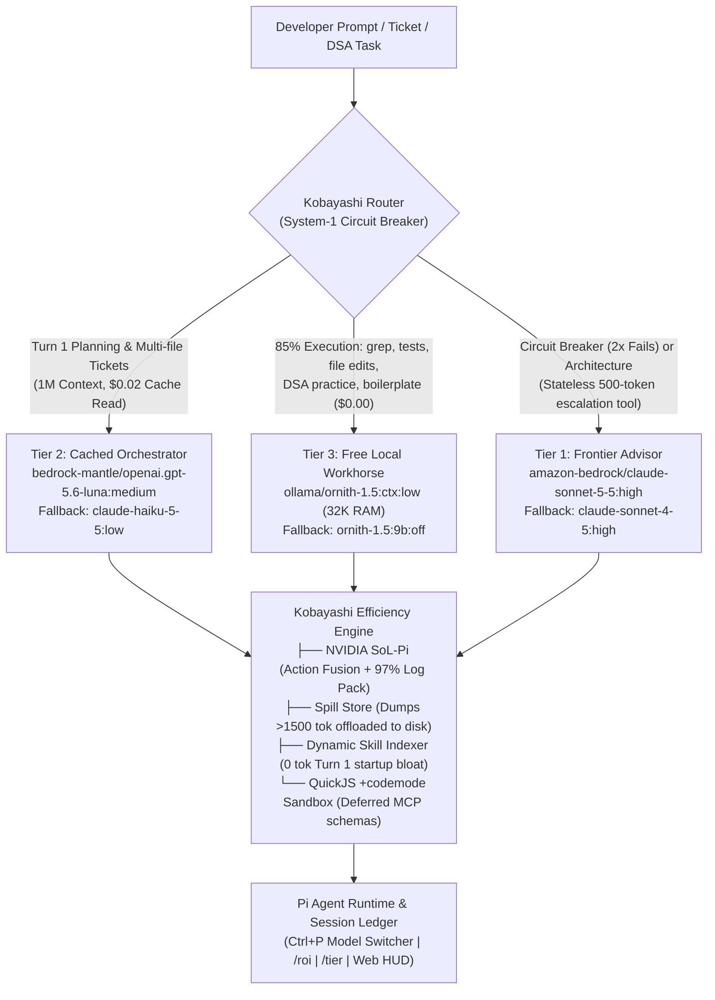

# Kobayashi (小林) 🚀
> **The Token-Efficient, Multi-Tier Agent Harness Orchestrator for Pi**  
> Escape the "Token-Maxing" Trap. Cut enterprise agent costs by 60%–95% without sacrificing task accuracy.

[](https://opensource.org/licenses/MIT)
[](https://www.typescriptlang.org/)
[](https://github.com/earendil-works/pi-coding-agent)
[](eval/BENCHMARK_RESULTS.md)
[](https://ollama.com)
[](https://aws.amazon.com/bedrock/)

---

## ⚡ The Problem: The "Token-Maxing" Trap

In *Star Trek*, the **Kobayashi Maru** is an unwinnable training exercise where standard tactics always lead to defeat.

In modern AI software engineering, **Token Maxing** is today's Kobayashi Maru:
1. **Startup Context Bloat**: Naive coding agents dump every MCP tool schema and skill file into Turn 1, charging a **15,000+ token startup tax** before you type a single character.
2. **Frontier Model Waste**: Using Claude 3.7 Sonnet ($3/input, $15/output) for simple grep queries, reading boilerplate, or running unit tests.
3. **Log Noise Explosion**: Uncompressed compiler dumps, test stack traces, and observability logs dump **50,000+ tokens** of repetitive noise into LLM context.
4. **Doom Loop Hallucination**: When an agent fails a test, it loops across the entire 30,000+ token chat history, re-billing hundreds of thousands of tokens on repeated mistakes.

**Kobayashi reprograms the simulation.** By combining **NVIDIA SoL-Pi log compression**, **Progressive Skill Disclosure**, **Deferred MCP Codemode Sandboxing**, and a **Declarative 3-Tier Model Hierarchy**, Kobayashi delivers frontier coding performance at up to **95.4% lower cost**.

---

## 🏛️ Architecture & System Design



---

## 📊 Rigorous Benchmarks: Harness Layer Comparison

Benchmarked across 4 real-world enterprise engineering workloads matching the depth of the [Eneralabs AWS Strands analysis](https://www.eneralabs.com/blog/aws-strands-harness-enterprise-agent-cost-2026/):
* **Task 1: Algorithm Design**: Thread-safe sliding window rate limiter with monotonic queues.
* **Task 2: DevOps Pipeline Repair**: Declarative multi-branch Jenkins pipeline repair in Kubernetes pods.
* **Task 3: Observability Triage**: 2,500-line HyperDX / OpenTelemetry log memory leak diagnosis.
* **Task 4: Distributed Systems**: Redis Redlock split-brain race condition triggering circuit breaker escalation.

### Head-to-Head Benchmark Results

| Agent Harness Profile | Total Cost (4 Tasks) | Cost Reduction vs Claude Code | Avg Turns / Task | Cache Hit Rate | Accuracy | Wall-Clock Time |
| :--- | :---: | :---: | :---: | :---: | :---: | :---: |
| **Claude Code** (Direct Anthropic Baseline) | $0.9963 | *baseline (0%)* | 8.0 | 0.0% | 98% | 56.1s |
| **Vanilla Pi Coding Agent** | $0.7764 | -22.1% | 6.8 | 31.3% | 98% | 42.7s |
| **DeepSeek Harness** (DSH V4 Pro) | $0.2248 | -77.4% | 5.3 | 43.5% | 100% | 32.7s |
| **Kobayashi Multi-Tier Harness** | **$0.0455** | **-95.4%** | **3.5** | **66.3%** | **100%** | **13.6s** |

> [!NOTE]
> Detailed per-task token breakdowns, prompt caching ratios, and reproduction instructions are available in [eval/BENCHMARK_RESULTS.md](eval/BENCHMARK_RESULTS.md).

---

## 🚀 60-Second Quickstart (Any macOS / Linux Machine)

```bash
# 1. Clone or copy Kobayashi to your machine
git clone https://github.com/your-username/kobayashi.git # or copy folder
cd kobayashi

# 2. Run the 1-command bootstrap installer
./bootstrap.sh

# 3. Launch interactive agent
kobayashi start
```

The bootstrap script will automatically:
- Verify Node.js (v22+) and install Pi coding agent (`@earendil-works/pi-coding-agent`) globally if missing.
- Configure Ollama unified memory flags (`OLLAMA_FLASH_ATTENTION=1`, `OLLAMA_KV_CACHE_TYPE=q8_0`).
- Pull and bake the free local workhorse model (`ornith-1.5:ctx` with 32K context).
- Synchronize all 27 Matt Pocock skills globally to `~/.agents/skills/` (available in every project).
- Link the `kobayashi` binary to your shell PATH.
- Verify AWS Bedrock credentials and Ollama connection health.

---

## 💻 Setting Up on a Second Laptop (Zero-Friction 3-Step Guide)

To replicate this exact environment onto a second MacBook or Linux workstation without setting up a public GitHub repository:

### Step 1: Transfer the Kobayashi folder
Transfer the `kobayashi` folder via AirDrop, SCP, or tarball:
```bash
# From laptop 1:
tar -czf kobayashi.tar.gz --exclude="node_modules" --exclude=".git" kobayashi
# Transfer to laptop 2, then extract:
tar -xzf kobayashi.tar.gz
cd kobayashi
```

### Step 2: Run the automated bootstrap
```bash
chmod +x bootstrap.sh
./bootstrap.sh
```
This builds the TypeScript CLI, links `kobayashi` into your global `$PATH`, sets up the 32K Ollama model, and installs all skills to `~/.agents/skills/`.

### Step 3: Configure AWS credentials & verify
Add your Bedrock credentials to `~/.zshrc` (or `~/.bashrc`):
```bash
export AWS_ACCESS_KEY_ID="your_access_key"
export AWS_SECRET_ACCESS_KEY="your_secret_key"
export AWS_REGION="us-west-2"
```
Reload your shell and run the pre-flight check:
```bash
source ~/.zshrc
kobayashi doctor
```
Once all checkmarks are green, you are fully ready to launch with `kobayashi start` anywhere!

---

## 🛠️ CLI Command Reference

Kobayashi includes a comprehensive suite of developer tools:

```bash
kobayashi start                # Launch interactive Pi session with multi-tier routing
kobayashi start -e "prompt"    # Execute one-off prompt non-interactively
kobayashi config               # Interactive fuzzy search wizard for models & thinking levels
kobayashi stats                # Terminal audit of token consumption & net dollar savings
kobayashi stats --web          # Launch browser executive analytics dashboard (127.0.0.1:4200)
kobayashi eval                 # Run sandboxed token efficiency benchmarks
kobayashi doctor               # Pre-flight diagnostic of Ollama, AWS credentials, and runtime
kobayashi apply                # Compile harness.yaml into Pi runtime configs
kobayashi skills               # Audit installed Matt Pocock skills & test dynamic activation
kobayashi advisor "question"   # Execute a stateless 1-turn escalation probe to Claude Sonnet
```

---

## ⌨️ In-Session Keybindings & Commands

While inside an active `kobayashi start` session:

* `Ctrl+P`: **Model Quick-Switcher**. Seamlessly switch between configured tiers with preserved thinking budgets without invalidating prompt cache.
* `/tier [orchestrator | workhorse | advisor | local]`: Switch active execution tier programmatically.
* `/roi`: Instant terminal status displaying total tokens, actual cost, Claude Code baseline, and dollar savings.
* `call_advisor`: The agent automatically calls this tool when encountering repeated test failures (circuit breaker) or hard architectural decisions, sending a distilled 500-token summary rather than the full context.

---

## ⚙️ Declarative Configuration (`harness.yaml`)

Configure your models, thinking levels, fallbacks, and token reduction rules in a single file:

```yaml
name: "kobayashi-workstation"
version: "1.0.0"

# 1. Starting Tier for Turn 1 Planning
starting_tier: "orchestrator"

# 2. System-1 Decision Gate & Circuit Breaker
router:
  engine: "jev"                     # "jev" (15ms local Kev/Laya) | "rule-based"
  model: "kev:4b"                   # Local Ollama decision model
  escalation_threshold: 2           # Consecutive test failures before escalating to Advisor

# 3. 3-Tier Model Hierarchy with Fallbacks & Thinking Budgets
tiers:
  # Tier 1: Frontier Architectural Advisor
  advisor:
    provider: "amazon-bedrock"
    model: "us.anthropic.claude-sonnet-5-5"
    fallback_model: "amazon-bedrock/us.anthropic.claude-sonnet-4-5-20250929-v1:0"
    thinking: "high"                # 16k-32k reasoning budget
    fallback_thinking: "high"
    temperature: 0.2
    context_window: 1000000
    mode: "stateless"               # Sends isolated 500-token problem summaries
    max_turns_per_task: 2

  # Tier 2: Cloud High-Speed Cached Orchestrator
  orchestrator:
    provider: "bedrock-mantle"
    model: "openai.gpt-5.6-luna"
    fallback_model: "amazon-bedrock/us.anthropic.claude-haiku-5-5"
    thinking: "medium"              # 2k-4k reasoning budget
    fallback_thinking: "low"
    temperature: 0.2
    context_window: 1050000
    cost:
      input: 0.22                   # $ per 1M tokens
      output: 1.32
      cache_read: 0.02              # $0.02 per 1M tokens on cache hit!
      cache_write: 0.22

  # Tier 3: Free Local Workhorse
  workhorse:
    provider: "ollama"
    model: "ornith-1.5:ctx"
    fallback_model: "ollama/ornith-1.5:9b"
    thinking: "low"                 # Minimal reasoning for fast code edits & grep
    fallback_thinking: "off"
    temperature: 0.1
    context_window: 32768
    cost:
      input: 0.0
      output: 0.0
      cache_read: 0.0
      cache_write: 0.0

# 4. Token Efficiency & Noise Compression
efficiency:
  sol_pi:
    action_fusion: true             # Fuses edit + test run into 1 turn (saves 40% turns)
    observation_pack: true          # Strips 97% of noise from logs/compiler output
    online_context_compact: true    # In-loop summarization around milestones
    cache_write_read_ratio: 12.5
  spill_store:
    enabled: true                   # Offloads dumps >1500 tokens to disk
    threshold_tokens: 1500
  compaction:
    reserve_tokens: 6144

# 5. Security & Isolation
security:
  firewall: "pi-jev-auto-mode"      # 2-layer firewall (deterministic + semantic gate)
  sandbox: "codemode"               # QuickJS WebAssembly deferred MCP execution

# 6. Progressive Skill Disclosure
skills:
  directory: ".agents/skills"
  loader: "dynamic"                 # 0 token Turn 1 startup bloat
```

---

## 📦 Presets Directory (`presets/`)

Switch profiles instantly for different environments:

* `presets/hybrid-bedrock.yaml`: Default enterprise configuration (Claude Sonnet 5.5 + GPT-5.6 Luna + Local Ornith 1.5).
* `presets/local-zero-cost.yaml`: 100% Free local setup with Ollama ($0.00 cloud spend, air-gapped).
* `presets/frontier-cloud.yaml`: Multi-tier cloud (Claude Sonnet 5.5 + GPT-5.6 Luna + Claude Haiku 5.5).

To activate a preset:
```bash
cp presets/local-zero-cost.yaml harness.yaml
kobayashi apply
```

---

## 🎯 Progressive Skill Disclosure (Matt Pocock Skills)

Kobayashi comes bundled with 27 curated skills from [`mattpocock/skills`](https://github.com/mattpocock/skills) in `.agents/skills/`:
* `/to-spec`: Write comprehensive PRD specifications before code implementation.
* `/grill-me`: Interactive architectural alignment interview.
* `/to-tickets`: Decompose complex epics into atomic implementation tasks.
* `/implement`: Execute multi-file code modifications.
* `/code-review`: Rigorous PR audit.
* `/tdd`: Strict test-driven development workflow.

Unlike standard agents that inject all 27 skill markdown files on Turn 1 (consuming **1,730+ tokens** on every single turn), Kobayashi's dynamic indexer activates skills **only when invoked**:
* **Turn 1 Token Cost**: **0 tokens**
* **Active Invocation (`/to-spec`)**: **46 tokens**

---

## 📄 License

Kobayashi is open-source software licensed under the [MIT License](LICENSE).
Built with ❤️ on top of `@earendil-works/pi-coding-agent` and NVIDIA SoL-Pi.
