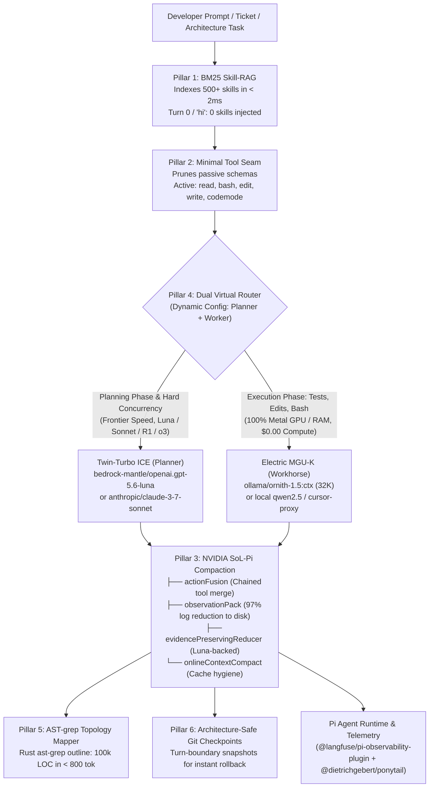

# Kobayashi Maru Architecture Deep Dive 🏛️

> Technical specification of the 6 runtime pillars powering the zero-waste engineering harness for Pi.

---



---

## Pillar 1: Active Aerodynamics — Okapi BM25 Skill-RAG (`skill-rag.ts`)

Standard agent harnesses dump every installed skill into the prompt, costing **37,500 tokens per turn** at 500 skills.

Kobayashi Maru implements **Zero-Dependency Skill Retrieval Augmentation (SRA)**:
- **In-Memory Index**: Indexes 500+ skills in memory in $< 2\text{ms}$ with Okapi BM25 ($k_1=1.2, b=0.75$).
- **Zero Cold-Start Bloat**: Generic greetings (`"hi"`, `"help"`, `"status"`) inject **0 skills** into context, preserving 100% of your token budget.
- **Intent-Driven Injection**: Matches user prompt keywords and mounts **only the top 1–2 matched skills** (~150 tokens).
- **Universal Tool Support**: Registers `find_skill` (with dual `execute` and `handler` methods) so models can search and mount any runbook mid-turn on demand.
- **Recursive Multi-Directory Scanning**: Automatically discovers nested `SKILL.md` files up to 3 levels deep from `~/.agents/skills`, `.agents/skills`, and custom imported repositories.

---

## Pillar 2: Lean Chassis — Minimal Tool Seam

Inspired by DeepSeek's SWE-bench harness design:
- Exposes only core engineering primitives: `read`, `bash`, `edit`, `write`, and `+codemode`.
- Dynamically hides passive diagnostic and usage tools (`fetch_budget_from_portkey`, `show_usage_stats`, `register_usage_budget`, `todo`) from the prompt schema.
- **Context-Gated Web Search**: Tools like `web_search` and `fetch_content` are excluded from prompt schemas unless web keywords (`jira`, `atlassian`, `search`, `url`, `http`) appear in the user prompt.

---

## Pillar 3: Telemetry & Downforce — NVIDIA SoL-Pi Compaction (`sol-pi.json`)

Developed in collaboration with NVIDIA SoL-Pi research patterns:
- **`actionFusion`**: Combines consecutive file reads and command outputs into unified, compact execution traces.
- **`observationPack`**: Evicts massive compiler dumps, stack traces, and test logs to disk, replacing them with concise summaries and an `obs_recall` reference.
- **`evidencePreservingReducer`**: Background summarization backed by Luna that compresses older turns while preserving file paths, variable names, and critical evidence.
- **`onlineContextCompact`**: Maintains a 12.5 cache write/read ratio to maximize Anthropic and Bedrock prompt cache hits.

---

## Pillar 4: Hybrid Powertrain — Dual Virtual Model Router (`bottom-up-router.ts`)

Provides two native in-process virtual model routes registered directly in Pi (`pi --model auto/...`):

### 1. `auto/planner-worker` (Top-Down Architecture)
- **Turn 1 (Planning)**: Routes to your configured Planner (e.g., Bedrock GPT-5.6 Luna, Claude 3.7 Sonnet, DeepSeek R1, OpenAI o3-mini) to analyze repository structure and formulate an execution plan.
- **Planning Seam Guard**: Keeps the planner engaged until synthesis is complete (prevents premature handoffs mid-tool-call).
- **Turns 2..N (Execution)**: Routes to your configured Workhorse (e.g., Local Ollama Ornith 1.5, Qwen 2.5 Coder, Cursor Fast) at **$0.00 compute cost**.
- **Circuit Breaker**: If the worker encounters consecutive failures (configurable, default: 2), execution automatically escalates back to the Planner.

### 2. `auto/bottom-up` (Bottom-Up Auto-Escalation)
- Starts directly on the local workhorse for $0.00 compute.
- Escalates to frontier intelligence only if consecutive tool failures occur.

### Dynamic Model Customization
All virtual models are fully configurable via `~/.pi/agent/virtual-models.json` or environment variables (`KOBAYASHI_PLANNER`, `KOBAYASHI_WORKER`):
```json
{
  "planner": {
    "provider": "bedrock-mantle",
    "model": "openai.gpt-5.6-luna",
    "thinking": "medium"
  },
  "worker": {
    "provider": "ollama",
    "model": "ornith-1.5:ctx",
    "thinking": "off"
  },
  "advisor": {
    "provider": "amazon-bedrock",
    "model": "us.anthropic.claude-sonnet-5-5",
    "thinking": "high"
  },
  "escalationThreshold": 2
}
```

---

## Pillar 5: Radar & LiDAR — AST-grep Monorepo Topology (`repo-mapper.ts`)

Powered by high-speed Rust `ast-grep outline` (v0.51.0):
- Extracts classes, methods, imports, and exports across 100k+ line codebases in **$< 800$ tokens**.
- Automatically creates an `EXPLORATION_MANIFEST.md` reference file.
- Prevents context-burning hallucination loops and blind grep searches.

---

## Pillar 6: Pit Crew — Architecture-Safe Git Checkpoints (`git-checkpoint.ts`)

- Detects working git binaries (`/opt/homebrew/bin/git`, `/usr/bin/git`, `git`) and validates architecture compatibility.
- Gracefully bypasses Rosetta/Intel CPU mismatch errors (`EBADARCH -86`) on Apple Silicon.
- Creates pre-turn `git stash` checkpoints before LLM modifications.
- Enables 1-click deterministic rollback if an agent makes breaking changes.
- Safe no-op outside git repositories with 0 unhandled exceptions.
